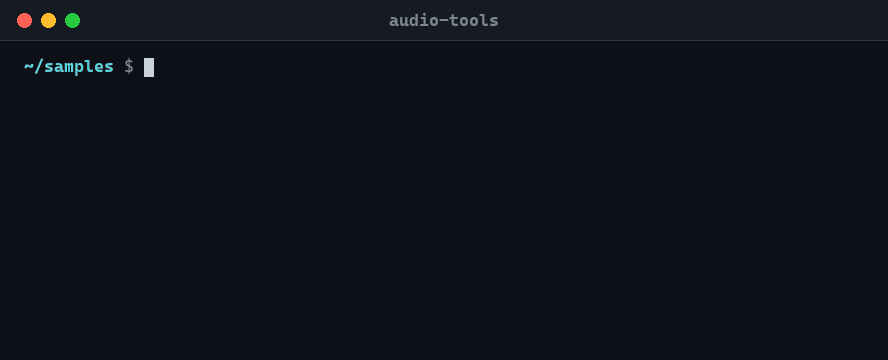
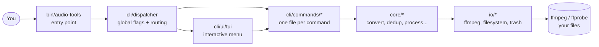

<div align="center">


<br>

**Convert, normalize, clean, dedupe and organize thousands of audio files from your terminal,<br>without ever losing a track to a typo.**

<br>

[](https://github.com/ekosistema/audio-tools/actions/workflows/ci.yml)
[](CHANGELOG.md)
[](LICENSE)
[](#-installation)
[](#-installation)
[](.github/workflows/ci.yml)
[](CONTRIBUTING.md)

[**Why**](#-why-audio-tools) ·
[**Demo**](#-see-it-in-action) ·
[**Install**](#-installation) ·
[**Quick start**](#-quick-start) ·
[**Commands**](#-commands) ·
[**Safety**](#-safety-first) ·
[**Contributing**](#-contributing)

</div>

---

## ✨ Why audio-tools?

You have a folder of 4,000 files named `Final mix (2) FINAL!!.wav`. Some are duplicates, some are
two-second glitches, half of them are too quiet. Doing that by hand is a weekend; doing it with
a one-off ffmpeg script is a *risky* weekend.

`audio-tools` is a single command that does the boring parts for you, and treats your files like they matter:

| | |
|---|---|
| 🛡️ **Safe by default** | Nothing is ever deleted for good: it goes to the trash. Destructive commands ask first, and `--dry-run` shows you what *would* happen. |
| 🤖 **Script-friendly** | Meaningful exit codes, `--json` output, global flags, no surprises when stdin is closed (CI, cron). |
| 🧭 **Beginner-friendly** | Run it with no arguments and a guided menu walks you through everything. |
| 🪶 **Featherweight** | It is Bash plus ffmpeg. No Python environment, no node_modules, nothing to build. |
| 🎨 **Pleasant to read** | Colorized menus, tables and previews on a terminal; plain text in pipes. Honors `NO_COLOR`, `--no-color` and `--color=always`. |
| 🎚️ **Respects your audio** | Sample rate and channel layout are preserved: your 96 kHz FLACs are not silently downgraded. |

---

## 🎬 See it in action

<div align="center">



</div>

<sub>A real session: the output was captured from audio-tools and replayed as an animation.
Look around, preview with <code>--dry-run</code>, do it, verify. The "deleted" duplicate is safe in the trash.</sub>

<details>
<summary><b>Prefer to read it? The same kind of session as text</b></summary>

> `~/samples` has four files: two identical kick drums, a pad and a one-shot click.

**Look around**

```console
$ audio-tools list --format table
FILENAME             FORMAT  SIZE   DURATION
───────────────────  ──────  ─────  ────────
ambient pad.wav      wav     861KB  10s
click.wav            wav     8KB    0s
kick one (copy).wav  wav     258KB  3s
kick one.wav         wav     258KB  3s
Total: 4 items

$ audio-tools stats
── Audio Stats ────────────────────────────────
  Files:        4
  Total duration: 0m 16s
  Total size:    1.4 MB

  By format:
    wav  4 files
```

**Find the clones, but look before you leap** (`--dry-run` never touches a file)

```console
$ audio-tools dedup --dry-run

── Duplicate group ──
  keep:      ./kick one (copy).wav
  duplicate: ./kick one.wav

  would move to trash: ./kick one.wav
[INFO] [dry run] Would delete 1 duplicate file(s)
```

**Preview a bulk conversion**

```console
$ audio-tools convert -f flac --dry-run
[INFO] [DRY RUN] Would convert 4 file(s) to flac in ./converted_mp3
  would convert: ./ambient pad.wav -> ./converted_mp3/ambient pad.flac
  would convert: ./click.wav -> ./converted_mp3/click.flac
  ...
```

**Sweep out the glitches** (anything shorter than 2 seconds)

```console
$ audio-tools remove short --threshold 2 --dry-run
  would move to trash: ./click.wav
[INFO] [dry run] Would delete 1 short files
```

**Prefer menus to flags?** Just run `audio-tools`:

```text
╔══════════════════════════════════════════════════════════════╗
║                      Audio Tools v3.1.0                      ║
║          Batch process audio files with confidence           ║
╚══════════════════════════════════════════════════════════════╝

CONVERSION & PROCESSING          CLEANUP & ORGANIZE
  1)  Convert audio                6)  Sanitize filenames
  2)  Normalize loudness           7)  Rename files with patterns
  3)  Trim silence                 8)  Scan & consolidate subfolders
  4)  Concatenate files            9)  Remove short/long files
  5)  Split at silence
                                 INSPECT & SEARCH
DEDUPLICATION                     12)  List all audio files
 10)  Find duplicates             13)  Stats
 11)  Dedup & remove              14)  Show file metadata
                                  15)  Search & extract/delete
```

<sub>(The real menu is a single column; it is shown in two here to save space.)</sub>

</details>

---

## 📦 Installation

**You need:** [ffmpeg](https://ffmpeg.org/) (with `ffprobe`) and **Bash 4.0+**.

```bash
git clone https://github.com/ekosistema/audio-tools.git
cd audio-tools
./install.sh
```

The installer copies the tool to `~/.local/share/audio-tools`, links it into `~/.local/bin`, sets up
tab completion for bash and zsh, and installs ffmpeg with your package manager if it is missing.

```bash
audio-tools --version   # audio-tools v3.1.0
```

<details>
<summary><b>Install ffmpeg by hand</b></summary>

| System          | Command                    |
|-----------------|----------------------------|
| Debian / Ubuntu | `sudo apt install ffmpeg`  |
| macOS           | `brew install ffmpeg`      |
| Arch Linux      | `sudo pacman -S ffmpeg`    |
| Fedora          | `sudo dnf install ffmpeg`  |
| RHEL / CentOS   | `sudo yum install ffmpeg`  |

</details>

<details>
<summary><b>Platform notes</b> (macOS, Windows/WSL)</summary>

- **Linux**: works out of the box.
- **macOS** ships Bash 3.2, which is too old. Run `brew install bash`; audio-tools starts with
  `#!/usr/bin/env bash`, so it picks up the Homebrew one. If your Bash is too old you get a clear message
  instead of a cryptic syntax error.
- **Windows**: run it inside [WSL](https://learn.microsoft.com/windows/wsl/install). Install ffmpeg in your
  WSL distro, then use the commands above. Windows paths are available under `/mnt/c/...`.

</details>

---

## 🚀 Quick start

```bash
# Walk through it with the guided menu
audio-tools

# Or go straight to the point
audio-tools convert ~/Music --format mp3 --bitrate 320k
audio-tools normalize ~/Recordings
audio-tools info track.flac
```

Golden rule: **when in doubt, add `--dry-run`.**

### Recipes

```bash
# Tidy a messy sample library
audio-tools scan ~/Downloads --output ALL_AUDIOS     # gather audio from every subfolder
audio-tools clean ALL_AUDIOS                          # "My Song (1)!.wav" -> "My_Song_1.wav"
audio-tools dedup ALL_AUDIOS                          # trash exact duplicates (asks first)
audio-tools remove short ALL_AUDIOS --threshold 1     # trash accidental clicks

# Make a podcast folder sound consistent
audio-tools normalize ~/podcast/raw                   # EBU R128, -16 LUFS -> ./processed
audio-tools trim-silence ~/podcast/raw                # strip dead air from both ends

# Hunt for a sound
audio-tools search kick --operation extract ~/samples # copies every "kick" file to ./kick_extracted

# Use it in scripts
audio-tools list ~/Music --json | jq '.files[] | select(.size > 50000000) | .path'
audio-tools --force remove long ~/Music --threshold 600   # no prompt, still goes to the trash
```

---

## 🧰 Commands

| Command | What it does |
|---|---|
| `convert` | Convert WAV/OGG/FLAC/AAC/WMA/M4A to MP3, OGG, AAC or FLAC at any bitrate |
| `normalize` | EBU R128 loudness normalization (−16 LUFS) |
| `trim-silence` | Remove leading and trailing silence |
| `split-silence` | Cut one long file into segments at the silences |
| `concat` | Join the files of a folder, in alphabetical order, into one |
| `clean` | Sanitize file names (spaces and special characters) |
| `rename` | Batch rename with tokens `{n}` `{orig}` `{ext}` `{date}` |
| `scan` | Copy audio from all subfolders into one flat folder |
| `remove short\|long` | Trash files shorter or longer than `--threshold` seconds |
| `dedup` | Trash exact duplicates (SHA256); the first path alphabetically is kept |
| `find-dupes` | List duplicate groups without touching anything |
| `search` | Find files by name, then `list`, `extract` or `delete` them |
| `list` | List files as `simple`, `table`, `tree` or `json` |
| `stats` | File count, total duration and size, breakdown by format |
| `info` | Bitrate, channels, sample rate, codec of one file |
| `config` | `list`, `get`, `set`, `reset`, `edit`, `path` |
| `completion` | Shell completion for `bash`, `zsh`, `fish` |

Every command has its own help: `audio-tools <command> --help`.

### Global flags

Put them before **or after** the command; `audio-tools --dry-run convert` and `audio-tools convert --dry-run` are the same.

| Flag | Meaning |
|---|---|
| `--dry-run` | Show what would happen; change nothing |
| `-f`, `--force` | Skip confirmation prompts (files still go to the trash) |
| `--no-force` | Always ask [default] |
| `--json` | Machine-readable output |
| `-q`, `--quiet` / `-v`, `--verbose` | Less / more output (`--quiet` never skips a delete confirmation) |
| `--color[=WHEN]` | `auto` (default: color only on a terminal), `always` or `never` |
| `--no-color` | Plain text (also honours [`NO_COLOR`](https://no-color.org/)) |
| `-C`, `--config FILE` | Use another config file |
| `-d`, `--directory PATH` | Target directory [default: current] |
| `-h`, `--help` / `-V`, `--version` | Help / version |

<sub>Short flags can mean different things per command (`-f` is `--format` in `convert`); the long forms above are always global.</sub>

<details>
<summary><b>Per-command options</b></summary>

| Command | Options |
|---|---|
| `convert` | `-f, --format mp3\|ogg\|aac\|flac` · `-b, --bitrate 192k` · `-o, --output DIR` · `--no-recursive` · `-p, --preview` |
| `remove` | `-t, --threshold SECONDS` (required) |
| `rename` | `-p, --pattern PAT` (required) |
| `clean` | `-p, --pattern REGEX` · `--replacement CHAR` · `--no-preview` |
| `scan` | `-o, --output DIR` · `--max-depth N` · `--no-preview` |
| `list` | `--format simple\|table\|tree\|json` · `--no-recursive` · `-p, --preview` |
| `search` | `-q, --query STRING` · `-o, --operation list\|extract\|delete` · `-i, --ignore-case` · `--output DIR` |

</details>

---

## 🛡️ Safety first

audio-tools is built for the "oops" moment.

1. **Everything goes to the trash.** macOS uses `~/.Trash`. Linux and WSL use `gio trash`, then `trash-put`,
   then the standard FreeDesktop trash in `~/.local/share/Trash`, with the metadata a file manager needs to
   **restore** the file. If none of that is possible, files land in a local `to_delete/` folder.
2. **Nothing overwrites anything.** A file with the same name in the trash gets a suffix (`song_2.mp3`).
3. **It asks first.** Destructive commands need a typed `yes`. With no one to ask (cron, CI, closed stdin) they exit
   with code `64` instead of guessing.
4. **`--dry-run` is a promise.** It never moves, converts or deletes a file.
5. **Half-written files do not exist.** Conversions render to a temporary `.part` file and are renamed only on success.

More detail in [`docs/safety.md`](docs/safety.md).

---

## ⚙️ Configuration

Defaults live in `~/.config/audio-tools/config.sh` (plain Bash, sourced at startup). Precedence:
**flags › environment › config file › built-in defaults.**

```bash
audio-tools config set bitrate 192k    # writes AUDIO_TOOLS_BITRATE
audio-tools config list
```

| Variable | Default | Purpose |
|---|---|---|
| `AUDIO_TOOLS_FORMAT` | `mp3` | Default output format for `convert` |
| `AUDIO_TOOLS_BITRATE` | `320k` | Default bitrate |
| `AUDIO_TOOLS_CONVERTED_DIR` | `converted_mp3` | Output folder for `convert` |
| `AUDIO_TOOLS_SCAN_DIR` | `ALL_AUDIOS` | Output folder for `scan` |
| `AUDIO_TOOLS_SAMPLE_RATE` | *source* | Force the output sample rate (Hz) |
| `AUDIO_TOOLS_CHANNELS` | *source* | Force the channel count |
| `AUDIO_TOOLS_FORCE` / `AUDIO_TOOLS_QUIET` | | Set to `yes` to skip prompts / silence output |
| `AUDIO_TOOLS_COLOR` | `auto` | `auto`, `always` or `never` (same as `--color`) |
| `AUDIO_TOOLS_CONFIG` | `~/.config/audio-tools/config.sh` | Config file path |
| `NO_COLOR` | | Disable colors |

### Exit codes

`0` success · `64` usage error (including "confirmation needed but no input") · `65` bad data ·
`69` ffmpeg/ffprobe missing · `74` I/O error. They follow [`sysexits.h`](https://man.freebsd.org/cgi/man.cgi?query=sysexits), so scripts can react to them.

---

## 🏗️ How it is built

Small, layered, easy to read, with no framework in sight.



Adding a command means dropping one file in `lib/cli/commands/`; the dispatcher discovers it by name.
The full tour is in [`docs/architecture.md`](docs/architecture.md).

---

## 🤝 Contributing

Bug reports, ideas and pull requests are very welcome, from typo fixes to new commands.

- 🐛 Found a bug? [Open an issue](https://github.com/ekosistema/audio-tools/issues/new/choose).
- 💡 Have an idea? Start a [feature request](https://github.com/ekosistema/audio-tools/issues/new/choose).
- 🔧 Want to code? Read [`CONTRIBUTING.md`](CONTRIBUTING.md), a five-minute guide to the dev setup, tests and conventions.
- 🔒 Security concern? See [`SECURITY.md`](SECURITY.md).

```bash
bash tests/setup.sh      # install bats + shellcheck
bats tests/bats/         # run the test suite
shellcheck -x bin/audio-tools lib/*/*.sh lib/cli/*/*.sh
```

Please be kind: this project follows the [Code of Conduct](CODE_OF_CONDUCT.md).

---

## 📜 License & credits

[MIT](LICENSE), made with care by [CeleroLab](https://celerolab.com?utm_source=audiotools&utm_medium=docs&utm_campaign=readme-license).
Audio magic by [FFmpeg](https://ffmpeg.org/); tests by [bats-core](https://github.com/bats-core/bats-core).

See what changed in each release in the [CHANGELOG](CHANGELOG.md).

<div align="center"><sub>If audio-tools saved you a weekend, a ⭐ is the nicest thank-you.</sub></div>
