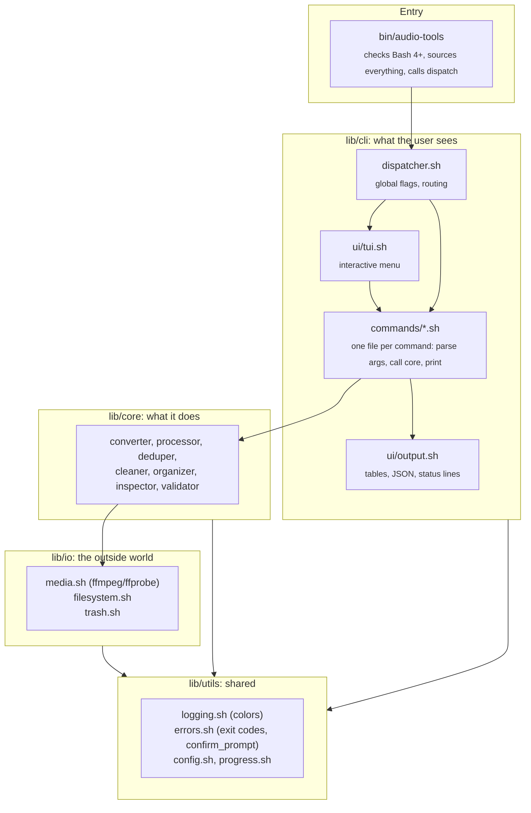

# Architecture

audio-tools is a few thousand lines of Bash with one rule: **each layer only talks to the one below it.**
That keeps it testable (every module can be sourced and tested on its own) and easy to change.

## The life of a command

`audio-tools --dry-run dedup ~/samples` goes like this:

1. **`bin/audio-tools`** refuses to run on Bash older than 4.0, sources all modules, answers
   `--help`/`--version` immediately, then checks that `ffmpeg` and `ffprobe` exist.
2. **`dispatcher.sh`** reads the global flags (`--dry-run`, `--json`, `--color`, `--force`, ...), both
   before and after the command name, finds the first non-flag word (`dedup`) and sources
   `lib/cli/commands/dedup.sh`.
3. **`init_colors`** decides, per stream, whether to color (`NO_COLOR`, `--color`, TTY or not).
4. **`cmd_dedup`** parses its own options and calls **`audio_dedup`** in `lib/core/deduper.sh`.
5. The core hashes the files, groups duplicates, and for each one calls **`move_to_trash`** in
   `lib/io/trash.sh`, which under `--dry-run` prints "would move to trash" and touches nothing.
6. The exit code follows [sysexits](https://man.freebsd.org/cgi/man.cgi?query=sysexits).

## Layers

| Layer | Directory | Rules |
|---|---|---|
| Entry | `bin/` | Thin: no logic beyond bootstrapping. |
| CLI | `lib/cli/` | Parses arguments, formats output, asks questions. Auto-discovers commands by file name. |
| Core | `lib/core/` | The actual work. Receives arguments, returns results; no menus, no argument parsing. |
| I/O | `lib/io/` | The only place that runs `ffmpeg`/`ffprobe` or moves files to the trash. |
| Utils | `lib/utils/` | Logging and colors, exit codes, config loading, progress. |

## Design decisions worth knowing

- **Command discovery by filename.** `lib/cli/commands/<name>.sh` defines `cmd_<name>()` (hyphens become
  underscores). Adding a command never requires editing a registry. See
  [`command-template.md`](command-template.md).
- **One chokepoint for deletion.** Everything destructive goes through `move_to_trash`. That is why
  `--dry-run`, the trash backends and the no-overwrite rule are implemented once.
- **Self-sourcing modules.** Each module sources what it needs if it is not already loaded, so a test can
  `source` one file and call its functions.
- **Colors are a palette, not escape codes.** `lib/utils/logging.sh` defines one set of variables per stream;
  everything else uses them. Turning color off empties the variables, so there is a single code path.
- **No dependencies beyond ffmpeg.** JSON is generated in pure Bash (`json_string`), duration math uses Bash
  arithmetic, and hashing uses `sha256sum`. There is no `jq`, `bc` or Python requirement.
- **Fail loudly, never guess.** With no input to answer a prompt, destructive commands exit `64` rather than
  assuming "yes" or "no".

## Testing

The suite lives in `tests/bats/` (170+ tests) and runs the real binary against audio fixtures in a temp
directory. Highlights:

- `test_safety.bats`, `test_dedup.bats`, `test_trash.bats`: nothing destructive happens without consent,
  `--dry-run` is honest, files are recoverable.
- `test_json.bats`: JSON is valid for hostile file names.
- `test_color.bats`: precedence of `NO_COLOR`, `--color`, `--json`, and piped output.
- `test_golden.bats`: `--help` output is pinned to `tests/golden/help.txt`.

Tests that could delete files stub `gio`/`trash-put` and point `XDG_DATA_HOME` at a temp directory, so running
the suite never touches your real trash.
